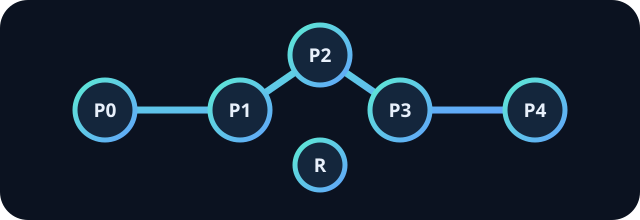

<div align="center">


<p><strong>An interactive, local-first Banker's algorithm simulator.</strong></p>
   
<br/>
</div>

## 🧭 Overview
Deadlock Avoidance Lab lets you edit allocation, maximum-demand, and available-resource matrices, then checks whether the state has a safe completion order. It runs locally and never interacts with operating-system processes.

## ✨ Features
- 🧮 Validates matrix dimensions and resource counts.
- 🔎 Calculates each process's remaining need.
- 🛡️ Finds a safe sequence or lists blocked processes.
- 🧾 Shows each resource-availability step.
- 🔒 Keeps all input in your browser.

## 🎬 Demo
Run the local app and load the built-in classic Banker’s algorithm example. The initial example should produce a safe sequence; edit the matrices to explore an unsafe state.

## 🚀 Quick Start
Requires Node.js 20 or newer.

```bash
npm start
```

Open http://127.0.0.1:4173. Run the automated checks with `npm test`.

## 🧰 Tech Stack
- 🟢 Node.js built-in HTTP server
- 🌐 HTML, CSS, and browser JavaScript modules
- 🧪 Node.js built-in test runner

## 🗂️ Folder Structure
```text
public/       Browser interface and algorithm
test/         Automated algorithm tests
assets/       Original project artwork
.github/      CI workflow
server.js     Dependency-free local server
```

## 🛣️ Roadmap
- [ ] Import and export problem files.
- [ ] Add step-by-step playback controls.
- [ ] Compare safe sequences across multiple states.

## 🤝 Contributing
Issues and pull requests are welcome. Keep the algorithm deterministic, add tests for edge cases, and avoid adding dependencies without a clear need.

## 📄 License
MIT. See [LICENSE](./LICENSE).

<div align="center"></div>
